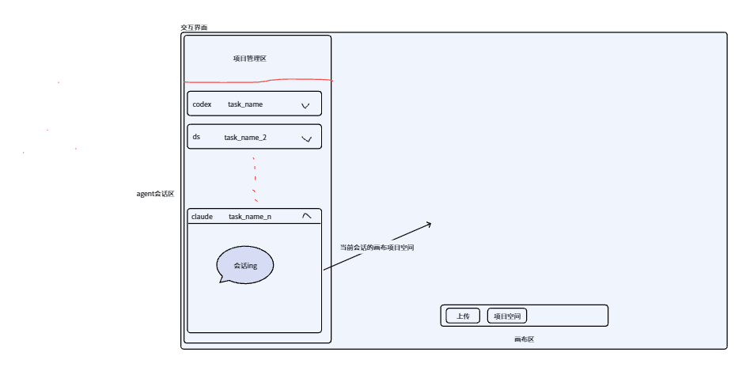
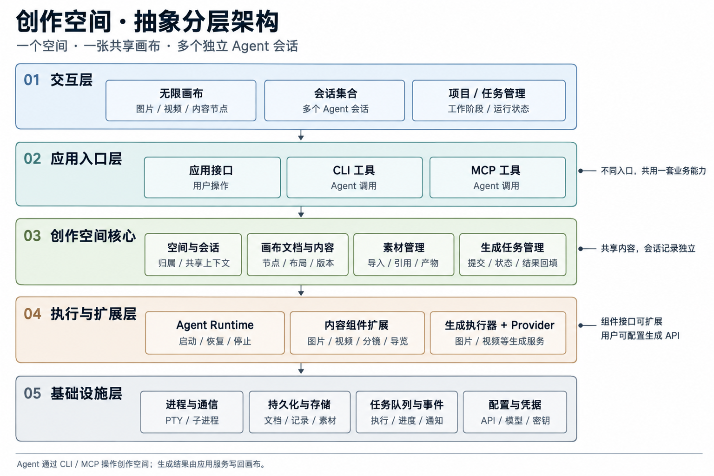
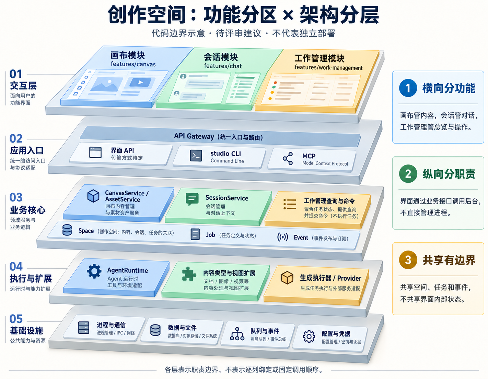

# 多 Agent 创作空间 · 架构设计

版本：v0\.1 讨论稿

更新日期：2026\-10\-25

文档类型：Design RFC

读者：产品负责人、架构与实现工程师

本文整理当前讨论中的产品共识和技术草案，用于后续评审与实现拆分。产品交互方向和进程职责边界已达成共识；模块接口、协议字段、状态机及技术选型仍需评审。本文不代表已实现或已验证的生产系统。

# 背景与目标

我们希望构建一个以图片、视频等内容为主体的创作空间。用户通过多个 Agent 会话发起创作、引用已有素材、继续修改；产物回到共享画布，便于查看、组织和比较。

界面原型已确认大体交互方向，视觉风格尚未定稿。Orca 的工作区组织、后台执行与 Agent 接入方式提供参考，但不会直接照搬其全部功能和运行结构。

第一版目标是打通：创建空间 → 发送消息与素材引用 → Agent 调用生成工具 → 后台执行 → 素材保存 → 结果回填画布。

第一版采用本地模式：画布工程与素材在本地保存，由本地后台管理 Agent 与生成任务；本地模式不限制调用在线模型或生成服务。云端画布与多人协作列为第十二章未来展望，不纳入首版交付；跨机器执行、复杂自动 DAG 调度及后台崩溃后全部 Agent 进程的无缝接管也暂不承诺。




# 已确认的产品模型

同一空间共享画布与素材，每个会话保留独立聊天记录。

|用户动作 / 视角|产品行为|
|---|---|
|切换会话 / 切换空间|会话内切换保留画布；空间切换同步切换画布与会话集合。|
|收起面板 / 切换会话|不隐式停止后台执行；逻辑会话、运行实例与生成任务分别管理。|
|项目与任务总览|工作阶段与运行活动分别显示，例如“待审阅”与“视频生成中”；任务结束不等于创作验收。|
|Agent 接入|结构化会话优先，PTY 作为兼容路径。|

**Orca 代码参考 · 已确认的产品模型**（v1\.4\.237）

[工作区与任务组织](https://github.com/stablyai/orca/blob/071747853f5995ee233b36751613f09a60007c2b/docs/site/content/docs/model/worktrees.mdx#L10) · [看板按状态组织工作区](https://github.com/stablyai/orca/blob/071747853f5995ee233b36751613f09a60007c2b/src/renderer/src/components/sidebar/use-workspace-kanban-board-projection.ts#L18)

借鉴工作区组织和按工作阶段展示看板的方式；“一个空间共享画布、包含多个独立会话”是本项目的产品设计，不是 Orca 已有的画布模型。

# 抽象分层架构



**三维视角：功能分区与代码分层**



|前端模块建议|保留在模块内部|通过接口协作|
|---|---|---|
|features/canvas|视口、选中态、拖拽交互|读取与修改节点；以明确的引用动作将素材交给会话。|
|features/chat|当前会话、输入草稿、消息展示|提交消息与素材引用；订阅会话和任务事件。|
|features/work\-management|筛选条件、分组、列表与看板展示|查询任务汇总；经业务服务发起操作，不自行持有进程或执行任务。|

共享的是 Space / Job / Event 等业务契约与数据；各界面模块通过公开接口协作，不直接读写彼此的私有状态。GenerationService 负责业务编排，生成执行器负责实际执行与 Provider 适配。

图中的向下箭头表示抽象依赖，不代表所有请求必须依次穿过五层。Agent 执行时通过 CLI 或 MCP 回调应用入口，这条回调关系在简化分层图中未完整展开。

|层级|职责|
|---|---|
|交互层|无限画布、会话集合、项目与任务管理|
|应用入口层|界面调用接口、CLI 工具、MCP 工具|
|创作空间核心|空间与会话归属、画布文档、素材、生成任务|
|执行与扩展层|Agent Runtime、内容类型与视图扩展、生成执行器及 Provider 适配|
|基础设施层|进程通信、持久化、文件存储、任务队列、事件、配置与凭据|

不同入口共用同一套业务服务。Agent 操作的是持久化内容对象，不直接访问前端组件实例；画布关闭时，后台仍可记录生成产物。

**Orca 代码参考 · 抽象分层架构**（v1\.4\.237）

[结构化启动与终端兼容路径](https://github.com/stablyai/orca/blob/071747853f5995ee233b36751613f09a60007c2b/src/main/agent-launch/agent-launch-executor.ts#L55) · [Agent 适配器与投递结果契约](https://github.com/stablyai/orca/blob/071747853f5995ee233b36751613f09a60007c2b/src/main/native-chat/agent-session-wire/structured-agent-session-adapter.ts#L179)

借鉴统一启动入口与 Agent 适配器边界。五层架构、三维图和 features/canvas 等目录为本项目方案，不能据此理解为 Orca 的原始目录或部署结构。

# 核心对象与约束

不要把逻辑会话等同于进程，也不要把画布节点等同于素材文件。

|需要守住的边界|约束建议|
|---|---|
|会话与运行实例|一个 Session 同时最多绑定一个有效实例。历史存在、上下文可恢复、原进程存活是三种保证。|
|引用与输入版本|媒体槽位通过 assetId 引用素材，文本槽位保存可版本化正文；排队期间跟随最新，开始执行时固定输入快照，Job 沿用本次输入。移动节点不改变槽位内容修订。|
|删除与替换|移除节点不立即删除仍被引用的素材；新结果默认追加为节点或新版本，覆盖需要明确操作。|
|交付与回填|Agent 可先创建节点并指定槽位；应用服务保存素材，按持久化绑定创建节点或填入已有槽位，交付不依赖 Agent 再次调用工具。|

## 素材引用与执行快照

已确认：排队期间跟随最新素材版本；本条消息开始执行时固定输入。具体边界是 Agent 已就绪、本条消息首次交给它之前，不是点击发送或启动进程的时刻。

|时点|素材状态|处理方式|
|---|---|---|
|发送并进入队列|当前素材为 v1|保存素材引用和“执行时取最新”策略，不锁定 v1。|
|等待期间编辑素材|素材更新为 v2|待发消息仍跟随最新，无需重新编辑引用。|
|开始执行|当前素材为 v2|解析并保存本次输入快照，再交给 Agent；记录实际使用 v2。|
|执行期间继续编辑|素材更新为 v3|当前执行仍使用 v2；之后的新执行默认解析 v3。|

|边界|规则|
|---|---|
|用户意图|引用哪份素材，以及“执行时取最新”的策略。|
|执行记录|保存本次解析出的 assetId、实际内容版本及可再次读取的素材引用；snapshotId 等字段暂作示意。|
|生成任务|继承本次执行中已解析的输入引用，不在 generation\.submit 时悄悄重取最新。|
|恢复与重试|恢复同一次执行、核对投递、下载或回填重试沿用原快照；新的创作执行才重新解析最新。|
|异常与保留|引用失效、不可访问或无法解析时明确提示，不静默换素材。被快照引用的版本在执行或恢复所需期间保持可读，清理规则另行确定。|

实现约束：输入快照应先持久化再投递；多素材引用需要形成可核对的一次解析结果。原子读取与版本保留的存储实现仍待评审。本节是创作空间的设计决定，不是对 Orca 已有画布能力的描述。

## 复合内容节点、镜头槽位与生成任务

已确认：内容生成与画布组织分开。四格漫画镜头节点默认包含四个可独立引用素材的槽位；生成调用、Job、产物与节点不要求一一对应。

|对象|职责与关系|
|---|---|
|复合内容节点|表示四格漫画等可编辑结构，保存组件类型、布局和槽位；不是一张固定合成图。|
|镜头槽位|保存对应镜头描述，独立引用素材；可以单独替换或重新生成。槽位具体数据结构待设计。|
|GenerationJob|执行生成并交付产物。一个节点可接收多个 Job 的结果；一次生成也可能产生多个镜头素材。|
|结果绑定|持久化记录预期产物与目标节点、槽位的对应关系，后台据此回填；不只保存在 Agent 上下文中。|

|生成方式|适用边界|
|---|---|
|一次生成完整四格图片|适合用户要求一张整体漫画图片；不能自动视为四个可独立编辑的镜头素材。|
|分别生成四个镜头|分别交付到四个槽位，支持局部重做；调用是否并行与跨镜头一致性方案待设计。|
|一次批量生成四个镜头|仅在生成工具支持返回独立产物时使用；组件结构不限定 Provider 调用次数。|

|步骤|执行与可见结果|
|---|---|
|1\. 建立结构|Agent 通过画布工具选择四格组件、创建节点，并写入四个镜头描述；画布服务校验并持久化。|
|2\. 提交生成|Agent 选择生成策略。后台在执行生成前保存结果与槽位的绑定关系，并关联本次执行的输入快照。|
|3\. 逐格交付|生成服务跟踪任务并保存素材；画布服务按绑定回填，已完成的槽位先展示，失败槽位单独呈现。|
|4\. 后续编辑|重做第三格只提交对应的新生成任务；替换图片或修改布局无需重新生成全部镜头。|

职责边界：Agent 表达组件选择、镜头内容、生成策略与目标位置；画布 CLI / MCP 调用统一业务入口，由服务完成实际写入。任务完成后的回填不依赖 Agent 再次调用画布工具。

已确认：槽位身份独立于排列顺序，内容变化与迟到结果冲突按下节组件规则处理。待设计：批量产物匹配、回填去重的实现与整体完成状态。整张导出作为组合操作，与可编辑原始结构分开。本节为本项目设计，不是 Orca 已有能力。

## 画布组件模型：布局、槽位与文本

已确认：第一版内容组件统一为“节点 \+ 槽位”，支持图片、视频与文本。组件可组合不同类型的槽位；槽位内容不绑定画布位置。

组件扩展原则（已确认）：图片、视频、文本、图文分镜与四格漫画是当前示例，不是封闭的组件清单。组件类型可按需扩展，并沿用节点、布局、稳定槽位及版本与回填规则。扩展注册、能力描述、渲染接入和兼容机制另行设计；本阶段不承诺插件市场或任意代码加载。


组件示例概念图：展示内容与槽位组合，不代表最终视觉风格或已实现界面；视频区域为静态示意，代码区域仅展示代码。

|层次|保存与负责的内容|
|---|---|
|节点|组件类型、画布位置和尺寸。|
|组件布局|槽位排列与内部展示区域；调整排列不改变槽位身份。|
|槽位|稳定标识、内容类型、描述、正文或素材引用、内容修订；允许暂时为空。|
|结果绑定|所属空间、目标节点和槽位，以及预期内容修订、当前接受的生成请求；不使用画布坐标定位交付目标。字段与存储结构待设计。|

|组件|槽位构成与用途|
|---|---|
|图片 / 视频|分别包含一个对应媒体槽位。|
|文本卡片 / 剧本|一个文本槽位，支持笔记、大纲、场景、对白、动作与旁白。|
|图文分镜|图片槽位与文本槽位组合，分别保存画面与镜头说明。|
|四格漫画|四个图片槽位，可配对应文本槽位；同一镜头的图片与文字通过镜头组组织，具体字段待接口评审。|

文本规则：第一版以 Markdown 源文作为正文，提供编辑与预览；预览支持标题、列表、表格、引用、链接与代码块高亮。完整富文本编辑器及结构化文档格式后续评审，不同时维护两份独立正文。文本的存储位置与素材版本的统一方式待设计。

版本规则：用户和 Agent 修改正文或替换素材时检查并更新槽位内容修订；执行前固定引用的文本版本。槽位标识不能使用当前排列序号，镜头换位后仍保持身份；移动节点或调整布局不更新槽位内容修订。

|生成期间发生的变化|回填行为|
|---|---|
|移动节点、调整排列或修改其他槽位|目标槽位仍存在且类型兼容时，不因此阻止回填。|
|目标内容已替换，或已有更新的生成请求|保存产物，阻止旧任务自动覆盖；通过任务卡片或 Agent 提示用户选择。|
|目标节点或槽位已删除|保存产物，不自动恢复已删除的节点或槽位。|

职责规则：组件模型定义结构与约束；画布 CLI 暴露读取、创建、修改、删除等操作；Skill 指导 Agent 组合操作。版本校验、回填去重与冲突检查由服务保证，后台交付不依赖再次唤醒 Agent。

MG 动画边界：剧本 / 分镜文本 → Agent 创建动画代码或工程 → 独立执行服务预览与渲染 → 视频槽位。Markdown 中显示代码不代表执行代码；本轮确认文本槽位，动画工程、资源依赖与运行预览作为后续扩展。

尚待设计：操作契约与字段、布局变更导致槽位增删或类型变化的处理、回填校验与写入的一致性。以上是本项目的组件模型设计，不是 Orca 已有能力，也不代表已实现。

## 组件发现与最小代码契约

已确认方向：组件可扩展，Agent 可动态查询能力；复合组件可用稳定的组标识组织相关槽位。下面的类型、命令与版本字段为接口草案，尚未实现。

|对象|伙伴需要了解的职责|
|---|---|
|ComponentRegistry|list 返回简短目录；describe 返回创建参数、槽位结构和可用操作。建议查询说明与执行校验消费同一注册定义。|
|ComponentDefinition|组件类型、定义版本、参数 schema、槽位组与操作 schema；定义版本不等同于槽位内容修订。|
|ComponentInstance|具体节点保存所用定义版本、布局、组标识与槽位标识；位置与内容分开。|
|镜头组|将同一镜头的图片和旁白组织在一起。组不是独立画布节点，换位时组与槽位身份保持稳定。|
|Skill 与 CLI|Skill 教创作流程，CLI 查询实际能力；新增组件不要求把全部说明写死到 Skill。|

示例流程：查询组件目录 → 读取图文分镜详情 → 创建四个镜头组 → 取得真实节点与槽位标识 → 写旁白 → 提交第一格生成并绑定图片槽位。命令名 list / describe 暂作示意。

```typescript
interface ComponentRegistry {
  list(): ComponentSummary[];
  describe(type: string, definitionVersion: number):
    ComponentDefinition | undefined;
}

interface DeliveryBinding {
  spaceId: string;
  nodeId: string;
  slotId: string;
  expectedContentRevision: number;
  generationRequestId: string;
}
```

代码仅展示接口边界，ComponentSummary / ComponentDefinition 的字段另行细化，不是完整可运行实现。回填检查与写入须保证一致性；模型传入的空间 ID 不能替代服务端权限校验。

待评审：schema 方言、组件注册与渲染接入、定义版本迁移、组的增删规则、操作返回值与错误码。

Orca 参考（1\.4\.237 文件哈希一致）：CLI 能力说明由实际命令定义生成；Skill 短入口加载当前 CLI 的版本匹配指南。这里借鉴发现方式，画布组件注册表是本项目方案。

[CLI 能力描述构造](https://github.com/stablyai/orca/blob/071747853f5995ee233b36751613f09a60007c2b/src/cli/agent-context.ts#L29)

[Skill 发现入口](https://github.com/stablyai/orca/blob/071747853f5995ee233b36751613f09a60007c2b/skill-stubs/orca-cli.md#L3)

## 画布工程格式与读写协议

已确认方向：画布采用可读的本地工程文件表达内容，作为正式持久化表达；Agent 可读文件、通过 CLI 操作，并用视觉预览补充判断。以下目录、字段和写入机制仍是设计草案。

|数据|建议保存位置与职责|
|---|---|
|工程入口与组件描述|space\.json 指向画布、素材目录与组件定义；组件描述不等于任意可执行渲染代码。|
|节点、组与槽位|canvas/nodes/\*\.json 保存稳定身份、组件定义版本与内容引用。|
|位置与排列|canvas/canvas\.json 保存节点位置、尺寸和组顺序，不写入槽位正文。|
|文本与媒体|content/\*\.md 保存正文；assets/ 保存素材，catalog 记录标识、版本、路径及校验值。|
|固定输入|\.studio/snapshots/ 为执行快照示例位置；真实保留、去重及只读保护方案待设计。|
|任务与缓存|队列、生成任务和投递记录属于运行存储；搜索与缩略图属于可重建缓存，不建立另一套独立的画布内容真源。|

三种感知方式互补：工程文件解释结构和文字；CLI 提供当前状态、快照读取与带校验的操作；节点预览或 Computer Use 用来判断实际画面和排版。读到图片路径不等于模型已经看到图片。

|操作路径|设计规则|
|---|---|
|读取当前工程|用于了解当前内容；不能把它当作已经固定的执行输入。|
|读取本轮内容|通过快照或 CLI 读取固定版本，延迟读取也不切回最新工程内容。|
|CLI 修改|统一服务校验版本、写文件、记录操作并通知界面；不能只靠 Skill 避免冲突。|
|外部文件编辑|经变更检测、结构校验、版本比较后接受或报告冲突；第一版样例未实现，不无条件加载覆盖。|
|渲染预览|从工程文件生成可查看内容；预览是派生结果，不是另一份可编辑真源。|

最小工程目录（示意）：

```plain text
space.json
components/storyboard.v1.json
canvas/canvas.json
canvas/nodes/storyboard-01.json
content/*.md
assets/catalog.json
assets/*.svg
.studio/snapshots/turn_example/
```

节点引用示例（省略其他字段）：

```json
{
  "groupId": "shot_arrival",
  "slots": [
    {
      "slotId": "slot_arrival_image",
      "contentRevision": 1,
      "assetId": "asset_arrival",
      "assetVersion": 1
    },
    {
      "slotId": "slot_arrival_text",
      "contentRevision": 1,
      "source": "content/arrival.md"
    }
  ]
}
```

本地验证样例已建立：四个镜头组、八个槽位、四份 Markdown 旁白与四张 SVG 示意图。预览从工程文件生成，可分别读取当前工程或固定快照；伙伴可按本文目录与引用示例理解格式，本地样例尚未作为附件上传飞书。

已验证：相对路径与素材校验值有效；镜头换位不改变组和槽位身份；修改当前正文不影响快照预览。预览只呈现节点内部内容，不模拟无限画布位置与缩放，仅支持标题和普通段落，不代表完整 Markdown 渲染能力。

操作批次、撤销以及保存与崩溃恢复的基本语义见本章对应小节。仍待设计：多文件提交协议的存储实现与验证、内容修订和撤销记录的维护、外部文件修改接入、备份与格式迁移、媒体版本清理，以及任务状态和内容交付之间的恢复机制。工程文本可比较，但媒体文件的版本管理策略另行决定；不是直接承诺把全部内容放进 Git。

## 画布连线：关联、参考与生成来源

已确认：连线是内容对象之间可查询、可解释的关系。第一版支持用户编辑“关联”和“参考”；生成来源由实际执行记录呈现。连线不默认触发任务，也不自动成为 Agent 的全部输入。

|关系|含义与方向|谁维护|
|---|---|---|
|关联 association|两个内容对象有关，无方向；两端的存储顺序不表达先后。|用户或 Agent 通过受校验操作维护。|
|参考 reference|参考来源 → 使用参考的内容，例如角色设定图 → 第三个镜头图片槽位。|用户或 Agent 维护创作意图；不证明生成已实际使用该参考。|
|生成来源|本次执行实际使用的素材版本 → 实际产物，关联输入快照、任务与结果。|后台根据执行记录产生；不允许用手动连线伪造历史。|

端点可以指向节点、镜头组或槽位，均使用稳定标识。普通拖线可先建立节点级关系，需要精确引用时再选择内部目标。节点移动与镜头换位不改变端点身份；线条锚点和绕行属于显示信息，不写进槽位内容。

最小数据示例（字段仍待接口评审）：

```json
{
  "connectionId": "connection_character_to_shot_c",
  "revision": 1,
  "kind": "reference",
  "source": {
    "nodeId": "node_character"
  },
  "target": {
    "nodeId": "node_storyboard",
    "slotId": "slot_shot_c_image"
  },
  "label": "角色外观参考"
}
```

建议将用户可编辑关系保存在 canvas/connections\.json，并由工程入口引用；具体文件拆分待定。生成来源从执行记录及其持久化来源信息投影，不能仅凭现有参考连线反推。运行日志清理后如何保留来源记录，另行设计。

|操作|一致性规则|
|---|---|
|创建|校验端点存在、内部对象归属与空间范围；同一请求重试不得重复创建。|
|移动节点 / 镜头换位|保持关系身份，只重新计算显示位置。|
|修改说明或端点|检查并更新连线自己的修订；改端点需重新校验，不修改节点内容版本。|
|删除连线|移除关系，不删除两端内容，不改写已有执行快照或生成来源。|
|删除节点、组或槽位|同次逻辑操作处理相关用户连线，避免悬空引用；跨文件提交的完整性由工程写入机制保证，具体实现待定。|
|撤销|按操作批次恢复对象及相关连线；另一端仍有效时恢复连线，否则报告未恢复项。具体冲突与部分恢复机制待设计，见“操作批次与撤销”。|

示例：角色设定图连接第三个镜头

|环节|用户 / Agent / 后台的行为|
|---|---|
|建立参考|用户从角色设定图连到第三个镜头的图片槽位；后台保存稳定端点和关系类型。|
|理解关系|Agent 查询目标的参考关系，按请求选择需要读取的内容；有线不代表必须读取全部相连素材。|
|固定输入|本轮已选定的输入在执行前解析并持久化为快照。执行中新增参考的快照扩展规则待设计，不能静默切换原有输入版本。|
|提交与交付|生成任务继承固定输入，并绑定第三个镜头的图片槽位；后台校验后回填，同时记录真实生成来源。|
|删除关系或目标|删除参考线不抹去历史。若目标槽位已删除，结果保存为素材，不自动重建目标；原有回填冲突规则继续适用。|

第一版不增加任务依赖连线；镜头顺序优先沿用组件内部排列。待决定：同端点重复关系、自连接、参考环路、跨空间关系、端点重连和来源关系的历史展示。请求去重不等于已经决定禁止用户创建语义相似的两条线。

本节是本项目设计共识与接口草案，不代表已实现连线功能，也不宣称对应 Orca 现有能力。

## 操作批次与撤销

已确认：第一版以一次已提交的操作批次作为撤销基本单位。撤销恢复画布内容，不倒退后台执行状态；用户与 Agent 的修改统一经过操作服务。具体记录格式待设计；多文件保存与恢复语义见“操作批次的保存与崩溃恢复”。

|层次|职责与例子|
|---|---|
|创作请求|关联一次用户意图下的活动，例如“第三格改为夜晚并修改旁白”；可包含多个操作批次和生成任务。|
|操作批次|一次实际提交的内容修改，例如更新旁白、删除节点及相关连线、图片成功回填。作为第一版撤销基本单位，不按底层文件逐一撤销。|
|生成任务|异步执行与交付，具有独立生命周期。与创作请求和相关修改关联，但不等同于可回滚的内容操作。|

例如“修改旁白并重新生成图片”：旁白保存形成一个批次；生成任务独立运行；图片成功回填再形成一个批次。两次内容修改与任务关联同一个创作请求，用户可以看到它们属于同一件事。第一版不默认支持一键撤销整次异步创作请求。

删除四格漫画，再撤销：

|对象|删除时|撤销时|
|---|---|---|
|漫画节点|从画布移除，保留恢复所需记录。|恢复节点、原位置及稳定标识。|
|镜头组与槽位|随节点移除，保留内容与身份记录。|恢复原组、槽位和内容；修订仍向前推进。|
|用户关联与参考连线|同批次处理指向被删除对象的线。|另一端仍有效时恢复，否则明确报告未恢复项。|
|媒体素材|不立即删除。|恢复引用，不重新生成素材。|
|生成历史|保留真实执行记录。|不改写历史，不将已完成任务恢复成未执行。|
|进行中的生成任务|不因删除节点默认取消；失去有效目标的结果保留为素材。|不重提任务，也不自动恢复旧任务的回填资格；需要明确选择是否填入。|

|操作记录至少包含|用途|
|---|---|
|操作编号、所属空间|唯一识别与定位操作。|
|发起者、执行者、操作说明|区分用户意图与 Agent 执行，让用户知道撤销什么。|
|涉及对象及修改前后内容|支持恢复节点、组、槽位和连线；以差异、快照还是其他方式保存待定。|
|当前状态检查条件|防止撤销旧操作覆盖后来发生的新修改。|
|创作请求编号与关联任务|把同步修改和异步生成联系起来，保留可追踪记录。|

撤销的三条约束：

1\. 先检查当前状态。若被影响内容已有后续修改，不能无条件恢复旧值；拒绝、部分恢复及确认交互的具体规则另行设计。

2\. 恢复内容时产生新的修订。例如修订 4 的正文被修改到修订 5，撤销后可以恢复修订 4 的正文，但当前修订成为 6，不退回 4。不能因此让迟到的旧生成结果重新通过回填校验。

3\. 不撤销外部执行。画布撤销不退还费用、不取消已完成生成，也不自动重发任务；取消任务通过独立操作处理。

记录保留期间应保证可撤销操作所需的内容仍可读取；具体保留期与素材清理规则待定。删除、撤销及恢复不能重用已失效的生成回填资格，相关代次或令牌机制需在后续接口中落实。

跨多个 JSON、Markdown 文件的完整提交、崩溃恢复与成功通知时机见“操作批次的保存与崩溃恢复”。仍待设计：撤销栈范围、连续编辑如何合并、重做以及冲突时的部分恢复策略。当前为已确认语义，尚未实现。

## 操作批次的保存与崩溃恢复

已确认：暂存修改 → 持久化提交决定 → 完成文件替换与核验 → 持久化完成记录 → 发布成功。提交决定之前可以放弃，之后恢复时继续完成该批次。以下为应用级保存与恢复语义，尚未实现或验证断电安全。

|阶段|服务执行的工作|对外状态|
|---|---|---|
|校验|检查对象存在、空间范围及版本条件。|尚未接受修改。|
|暂存|准备完整新内容、恢复所需旧内容与文件变更清单；正式内容不变。|保存中。|
|确定提交|在恢复材料准备完整后，持久化提交决定。|保存中，尚不返回保存成功。|
|应用修改|按清单替换文件并核对结果；可识别已经应用的步骤。|保存中，不发布半完成的新版本。|
|完成发布|持久化完成记录，再返回成功回执并通知界面。|已保存。|

事务目录示例（名称和具体记录格式待定）：

```plain text
.studio/transactions/operation_123/
  manifest.json     操作编号、版本条件、文件清单与校验信息
  before/           恢复或撤销所需旧内容
  after/            准备写入的新内容
  ...               提交决定与完成记录
```

删除先通过移除引用或删除标记表达，恢复所需文件不提前清理。逐个替换文件本身不是整个批次的原子提交；完整性由统一操作服务、提交记录、读取隔离和恢复流程共同实现。

|中断位置|重启后的行为|
|---|---|
|暂存未完成|保持正式内容不变，清理不完整准备。|
|暂存完成，但无提交决定|保持原状态，不自动提交。|
|已决定提交，只替换部分文件|核对清单与现有结果，继续完成剩余写入。|
|文件已更新，完成记录缺失|核验结果，补齐完成记录。|
|已完成，但回执或界面通知未送达|按原操作编号查询已提交结果，不重复执行修改。|
|恢复时发现无法匹配的外部修改|暂停该工程写入并报告冲突，不盲目覆盖。|

operationId 标识同一操作批次。相同编号重试应查询或继续原批次，不生成第二次修改；相同编号携带不同操作内容应拒绝，具体指纹与回执格式待接口评审。

|读取或执行方|隔离规则|
|---|---|
|空间操作服务|第一版每个空间串行提交短暂的写入批次；启动后先处理未完成提交，再开放该工程正常写入。Agent 推理与生成任务不因此整体串行。|
|界面与 CLI|只发布已提交的逻辑状态；中间文件状态不得作为完整新版本返回。恢复期间读取旧快照或暂停一致读取，具体实现待定。|
|执行中的 Agent|按固定输入快照读取，延迟读取也保持同一版本。|
|外部工具直接读工程目录|不承诺跨多个文件的一致视图；需要一致读取时使用服务提供的固定快照。|
|界面即时反馈|可即时展示拖动或输入，但明确保留“保存中”状态；只有完整提交后才能显示已保存。|

撤销使用同一提交机制：读取原批次恢复信息 → 检查当前状态 → 生成恢复内容与新修订 → 暂存并提交。不能直接复制旧文件来绕过校验，也不能倒退任务状态。

落地仍需评审：事务记录使用数据库还是文件日志、持久化与文件替换顺序、同空间写入权协调、文件操作失败与磁盘空间不足的处理、完成事件补发、事务清理和故障注入测试。断电与存储设备行为需单独验证，不因确认恢复流程就宣称具备断电安全。

本节仅定义本地模式的设计语义，不把工程文件、运行数据库和外部生成服务视为同一个原子事务；生成交付的幂等与 finalizing 恢复继续遵守第八、九章。

## 对象身份与版本规则

已确认：标识回答“它是谁”，版本回答“它发生了什么变化”。修改通常保留身份，复制产生新身份，撤销不倒退修订。下面字段名与版本粒度为接口草案，语义不等于已实现。

|字段示意|负责什么|变化时机|
|---|---|---|
|formatVersion|工程文件格式。|工程格式迁移时。|
|definitionVersion|组件结构与能力。|组件定义发布新版本；已有实例经明确迁移后更新所用版本。|
|layoutRevision|节点位置、尺寸及镜头组排列。|对应布局变化时；按画布、节点或布局对象划分的具体粒度待定。|
|contentRevision|单个槽位正文或素材引用。|修改正文、替换素材、清空或恢复内容时。|
|assetVersion|实际媒体内容。|同一素材产生新的内容版本时；旧版本不原地覆盖。|
|generationRequestId|槽位当前接受哪次生成。|新生成请求被后台接受时更新；它是请求身份，不是内容修订号。|

|操作|身份与修订规则|
|---|---|
|移动或缩放节点|节点、组、槽位标识不变，只更新相关布局修订。|
|调整镜头顺序|组和槽位标识不变，更新排列修订。|
|修改旁白|文本槽位身份不变，只增加对应内容修订。|
|替换图片|图片槽位身份不变，更新素材引用并增加内容修订。|
|复制整个漫画节点|创建新的节点、组和槽位标识；初始可引用相同素材版本，不继承旧生成请求的回填资格。|
|删除后撤销|恢复原稳定标识与内容；修订不倒退，旧生成请求的回填资格不自动恢复。|
|删除后重新创建|是新对象，不能复用被删除对象的标识。|
|再次发起生成|可暂时保留原内容；接受新请求后，旧请求失去自动回填资格。|

复制后的共享引用不等于共享编辑：两个槽位可以引用同一图片版本，替换其中一个槽位只更新它自己的引用。旧媒体版本保持可读取，不能原地改写已被其他槽位或快照引用的内容。文本复制也应保持独立编辑语义，具体文件复制或版本引用方式待定。

示例：第三格内容修订为 5，当前接受请求 A；用户再次发起生成，后台接受请求 B。原图仍显示，内容修订可仍为 5，但当前接受请求已变为 B。A 即使先完成，也只能保留产物，不能自动回填。

|回填前需要检查|目的|
|---|---|
|目标节点、槽位仍存在且类型兼容|不恢复已删除目标，不把不兼容内容填入槽位。|
|当前内容修订符合提交时的条件|不覆盖用户或其他 Agent 后来的修改。|
|当前接受的请求仍是本次请求|防止内容未变时，旧任务覆盖新的生成意图。|
|同一结果未完成过交付|重复通知或恢复重试不重复修改内容。|

上述检查与实际写入必须通过统一操作服务一致地完成，不能先检查后无条件写入。恢复节点后如需使用旧任务产物，应明确执行“填入素材”，形成新的受校验内容修改，不复活原请求的自动回填资格。

待评审：修订粒度与维护方式、生成请求及输出的匹配字段、删除与恢复时的资格失效机制、复制连线和来源的处理、组件定义迁移。已有连线修订、操作编号和输入快照编号保留各自职责，不合并为一个全局版本。

**Orca 代码参考 · 核心对象与约束**（v1\.4\.237）

[逻辑会话、租约与运行进程身份](https://github.com/stablyai/orca/blob/071747853f5995ee233b36751613f09a60007c2b/src/shared/agent-session-record.ts#L109) · [先建立会话再唤醒投递](https://github.com/stablyai/orca/blob/071747853f5995ee233b36751613f09a60007c2b/src/main/native-chat/agent-session-wire/structured-agent-session-create.ts#L45)

借鉴逻辑会话、运行进程身份与持久化记录的分离。Space、ContentNode、Asset、GenerationJob、Attempt 的关系及素材版本规则为本项目建议。

# 后台模块划分

队列职责：SessionService 管理待发草稿、排队条件与正式提交记录；AgentRuntime 经适配器执行正式投递，并回报投递与运行事件。

以下是建议的代码模块，不是八个独立部署服务。第一版拟运行在一个本地后台服务中。

|模块|主要职责|
|---|---|
|Gateway|本机连接认证、版本协商、参数校验、请求去重、订阅入口|
|SpaceService|空间、会话归属、共享简报、访问范围|
|SessionService|消息与引用保存、回合排队、调用 AgentRuntime|
|AgentRuntime|Agent 启动、恢复、收发事件、停止与退出确认|
|CanvasService|节点、布局、版本检查、内容关系与结果放置|
|AssetService|导入、下载、文件保存、元数据、预览与引用|
|GenerationService|Job / Attempt、Provider 调用、状态核对、结果回填|
|EventService|重要事件保存、订阅、补发与快照游标|

数据库、文件存储和凭据存储是共享底层依赖。Agent 适配器封装原生协议、SDK 或 PTY 差异；Provider 适配器封装生成 API 的参数、查询、下载和取消能力。

## Agent 上下文与状态 Hook：职责分离

设计建议：让 Agent 明确所属空间、工具入口和本轮输入；状态 Hook 单独负责运行事件回报。环境变量可供工具继承，但不会自动成为模型已读到的说明。接口与具体 Provider 适配方式待评审。

|内容|准备时点与责任|
|---|---|
|会话上下文|启动或恢复时由后台准备：spaceId、sessionId、工作目录、CLI 入口与指南版本。|
|回合上下文|本条消息开始执行前固定：turnId、目标引用与 inputSnapshotId。恢复同一次执行沿用原快照。|
|组件能力|Agent 按需查询目录和详情，避免把所有组件说明注入每次对话。|
|AgentContextBuilder|组装中立上下文；AgentAdapter 使用经过验证的指令字段、Skill 目录或其他受支持通道交付。|
|状态 Hook / 协议事件|把运行状态送回 AgentRuntime，再经持久化与事件服务更新任务管理区。|

```typescript
interface AgentSessionContext {
  spaceId: string;
  sessionId: string;
  workspaceRoot: string;
  cliExecutable: string;
  skillGuideVersion: string;
}

interface AgentTurnContext {
  turnId: string;
  inputSnapshotId: string;
  targets: { nodeId: string; slotId?: string }[];
}
```

目标与内容版本分开：发送时保存引用意图；执行时解析这些引用的最新内容。用户后来切换空间或选区，不能悄悄更换已排队消息的目标。后台根据可信调用身份核对空间范围，不能只信模型提供的 ID。

|Orca 观察|证据与适用边界|
|---|---|
|工作区身份|终端环境设置 ORCA\_WORKSPACE\_ID，文件夹工作区还带根路径；CLI 结合 cwd、环境身份和工作区目录解析目标。|
|结构化会话|单独设置会话身份并清理继承的终端身份；不能直接沿用终端 pane 身份。|
|Claude 状态 Hook|检查到的脚本刷新 endpoint 并 POST 事件，输出空 JSON；这段脚本不是工作区说明注入，不推断所有 Provider 都没有上下文 Hook。|

证据版本：CLI 能力描述、工作区选择器与 Skill 入口已和 1\.4\.237（0717478）快照做 blob 哈希比对。环境封装与 Hook 观察来自本地完整仓库 1\.4\.214（0805f1c），不冒充同一版本。均为静态阅读，未运行 Agent 集成验证；本轮远程固定提交原文返回 404，链接保留精确提交供有访问权限的伙伴核对。

[工作区解析 · 1\.4\.237](https://github.com/stablyai/orca/blob/071747853f5995ee233b36751613f09a60007c2b/src/cli/agent-workspace-selector.ts#L14)

[终端工作区环境 · 1\.4\.214](https://github.com/stablyai/orca/blob/0805f1cd70cb73f528758a90d11fcef16f032c18/src/main/runtime/terminal/launch/terminal-workspace-scope.ts#L191)

[结构化会话身份 · 1\.4\.214](https://github.com/stablyai/orca/blob/0805f1cd70cb73f528758a90d11fcef16f032c18/src/main/runtime/structured-session-child-env.ts#L107)

[Claude 状态 Hook · 1\.4\.214](https://github.com/stablyai/orca/blob/0805f1cd70cb73f528758a90d11fcef16f032c18/src/main/claude/hook-script.ts#L30)

下一步评审：启动时模型可见的空间说明模板、不同 Agent 的实际注入通道、上下文更新与恢复规则。上述内容是设计与源码观察，不代表已实现。

## 从消息提交到 Agent 运行：Orca 源码对照

**核心结论**：会话先保存用户意图，Runtime 再执行；进程启动、消息收到、回合完成是三件不同的事。

**一条消息怎么走**

**职责怎么分 · 待评审建议**

|模块|负责内容|边界|
|---|---|---|
|SessionService|消息、引用、输入版本、队列与历史|保存意图，记录投递结果|
|AgentRuntime|运行实例、就绪与生命周期|调度适配器和进程管理|
|AgentAdapter|原生协议、能力差异、事件翻译|Runtime 内部模块|
|ProcessSupervisor|OS 进程、管道与退出证据|Runtime 内部模块|

**状态怎么记 · 三个独立维度**

|维度|回答的问题|状态示例（非完整状态机）|
|---|---|---|
|消息投递|Agent 是否收到？|已保存 / 已接管 / 结果未知|
|回合执行|这一轮是否完成？|运行中 / 等待用户 / 已结束|
|进程实例|执行载体是否可用？|启动中 / 就绪 / 已退出|

**超时不等于没收到。**结果未知时先核对，不能自动重发同一条消息。

**Orca 的实际做法**：先建会话与 journal，再唤醒投递；适配器区分 acquire / open / dispatch；事件先写 journal 再发布。Codex 使用协议连接，Claude 使用 SDK 自定义进程启动。

**实现时保留**：消息 ID 与内容指纹共同去重；缓冲发布前事件并隔离旧实例；素材版本由会话层在本条消息开始执行前解析并固定；进程层处理 stderr 与退出证据。跨平台退出策略需分别确认。

**源码依据 · 按需查阅**：Orca 1\.4\.237 固定提交，静态阅读，未做端到端验证。以下链接保留具体实现。

- [会话建立与唤醒投递](https://github.com/stablyai/orca/blob/071747853f5995ee233b36751613f09a60007c2b/src/main/native-chat/agent-session-wire/structured-agent-session-create.ts)

- [消息记录与重复提交处理](https://github.com/stablyai/orca/blob/071747853f5995ee233b36751613f09a60007c2b/src/main/native-chat/agent-session-wire/structured-agent-session-turns.ts)

- [适配器投递结果契约](https://github.com/stablyai/orca/blob/071747853f5995ee233b36751613f09a60007c2b/src/main/native-chat/agent-session-wire/structured-agent-session-adapter.ts)

- [Codex 适配器与事件发布](https://github.com/stablyai/orca/blob/071747853f5995ee233b36751613f09a60007c2b/src/main/codex/codex-structured-session-adapter.ts)

- [Codex 协议握手与会话打开](https://github.com/stablyai/orca/blob/071747853f5995ee233b36751613f09a60007c2b/src/main/codex/codex-structured-session-start.ts)

- [Codex 回合提交](https://github.com/stablyai/orca/blob/071747853f5995ee233b36751613f09a60007c2b/src/main/codex/codex-structured-turn-start.ts)

- [受管理进程](https://github.com/stablyai/orca/blob/071747853f5995ee233b36751613f09a60007c2b/src/main/provider-process/managed-provider-process.ts)

- [Claude SDK 自定义进程启动](https://github.com/stablyai/orca/blob/071747853f5995ee233b36751613f09a60007c2b/src/main/claude/claude-agent-sdk-process-spawn.ts)

# 进程与通信草案

后台持有执行与业务状态；界面、CLI 和 MCP 都通过受控入口访问它。

|通信环节|设计草案|
|---|---|
|连接建立|验证凭据，协商协议版本与能力，返回 runtimeEpoch；后台重启后重新核对状态。|
|协议与传输|内部拟采用 JSON\-RPC 2\.0；本机 Pipe / Socket 与 MCP stdio 是不同通信段，选型尚未定稿。|
|不同请求的响应|查询直接返回；短修改保存后返回；消息和生成提交持久化后返回 ID，执行变化走事件。|
|CLI / MCP 边界|不自行保存画布、不持有生成任务、不直接读取生成服务密钥；后台按可信身份限制空间范围。|

时序细节：会话启动与界面重连

**Orca 代码参考 · 进程与通信草案**（v1\.4\.237）

[本机 socket 连接](https://github.com/stablyai/orca/blob/071747853f5995ee233b36751613f09a60007c2b/src/main/daemon/daemon-client-socket-connect.ts#L5) · [daemon 握手：令牌与版本](https://github.com/stablyai/orca/blob/071747853f5995ee233b36751613f09a60007c2b/src/main/daemon/daemon-client-hello-handshake.ts#L29) · [Codex 子进程协议连接](https://github.com/stablyai/orca/blob/071747853f5995ee233b36751613f09a60007c2b/src/main/codex/codex-app-server-connection.ts#L266) · [Claude SDK 自定义进程启动](https://github.com/stablyai/orca/blob/071747853f5995ee233b36751613f09a60007c2b/src/main/claude/claude-agent-sdk-process-spawn.ts#L45)

参考本机连接、握手验证及不同 Agent 的进程接入。Orca daemon 有自己的消息协议；本文统一 JSON\-RPC、MCP 桥接与 runtimeEpoch 仍是设计草案，不能把 daemon 与结构化会话视为同一种协议或生命周期。

# 消息、幂等与事件草案

## 消息排队与即时发送

默认等待当前工作结束后再发送；用户可显式选择立即发送。待发草稿与正式提交分别记录。

正常发送路径的简化图；所有路径都需要通过权限、输入有效性等共同检查。“立即发送”也不能绕过待回答事项或安全限制。

|情况|系统行为|用户看到什么|
|---|---|---|
|无当前工作、无阻塞或积压|保存正式提交并投递|正在发送|
|Agent 正在工作|默认保存为待发草稿|等待发送|
|Agent 等待回答或授权|暂停自动发送，先处理待回答事项|需先回答或授权|
|用户选择立即发送|检查条件后走即时路径；行为由适配器决定|投递结果，或不能立即发送的原因|
|当前工作结束|重新检查条件，按顺序取出可发送草稿|下一条开始发送|
|正式提交结果未知|保留记录并核对，不自动重复投递|发送结果待确认|

待发草稿只保存后续意图，进入正式提交后才跟踪投递结果。“立即发送”可能成为中途指导，具体由适配器决定；停止当前回合是独立操作。

参考 Orca 1\.4\.237 的默认排队、待发草稿与正式提交分离设计；本文仍为待评审方案。队列编辑、撤回、重启后是否自动续发等规则另行确定。

## 停止与恢复：继承 Orca

采用 Orca v1\.4\.237 的停止语义作为实现基线：停止当前工作，暂停后续自动发送，保留待发草稿；运行实例是否结束由适配器与中断结果决定。当前为设计决定，尚未实现或端到端验证。

|环节|采用的行为|
|---|---|
|确认停止对象|按会话、运行代次与目标回合核对实时状态，避免迟到的 Stop 误停下一轮。|
|先记录停止意图|停止事件、操作回执与尚未交给 Agent 的正式提交撤回，在同一事务接受；接受失败不执行中断。待发草稿不被撤回或清空。|
|暂停待发队列|草稿卡片继续显示，暂停自动发送，避免当前工作一停，后续消息立即接着执行。|
|中断与进程收尾|调用适配器中断；需要结束子进程的适配器继续收尾。中断失败且目标仍在运行时，可自动结束对应子进程，不额外要求用户确认。|
|确认停止结果|接受请求不等于执行已经停止。依据回合或进程的结束证据更新状态；缺少确认时继续核对，不虚报停止成功。|
|恢复发送|显式恢复可解除暂停；Stop 之后的新发送形成被接受的回合也可解除。对单张草稿“立即发送”时，在该卡片的回合开始前不放开其余队列。|

停止当前工作可以结束运行实例，但不删除逻辑会话与历史。不要承诺“停止后一定保留进程”；例如该版本 Claude 适配器声明 stopEndsSession = true，下一次发送再恢复会话。

本项目扩展：独立 GenerationJob 的取消单独设计，不能从 Orca 的 Agent Stop 推导。当前建议仍是不自动取消独立生成任务；Provider 的取消能力与确认机制另行定义。

**Orca 代码参考 · 停止与恢复**（v1\.4\.237）

[停止、草稿保留与队列恢复](https://github.com/stablyai/orca/blob/071747853f5995ee233b36751613f09a60007c2b/src/main/native-chat/agent-session-wire/structured-agent-session-queued-stop.ts#L1) · [停止意图的原子接受](https://github.com/stablyai/orca/blob/071747853f5995ee233b36751613f09a60007c2b/src/main/native-chat/agent-session-journal/journal-stop-acceptance.ts#L1) · [适配器停止契约](https://github.com/stablyai/orca/blob/071747853f5995ee233b36751613f09a60007c2b/src/main/native-chat/agent-session-wire/structured-agent-session-adapter-stop.ts#L25) · [中断失败后的进程收尾](https://github.com/stablyai/orca/blob/071747853f5995ee233b36751613f09a60007c2b/src/main/native-chat/agent-session-wire/structured-agent-session-turns-cancel.ts#L238) · [Claude 的停止策略](https://github.com/stablyai/orca/blob/071747853f5995ee233b36751613f09a60007c2b/src/main/claude/claude-structured-session-adapter.ts#L185)

## 消息标识与幂等规则

RPC id 识别一次通信；requestId 识别一次业务意图。重试不能制造第二次创作。

|标识|回答什么问题|重试 / 重连时|
|---|---|---|
|RPC id|这条响应对应哪次调用？|用于匹配单次请求与响应。|
|requestId|是否同一个业务操作？|同内容复用；返回已有结果或状态。换内容则报冲突。|
|messageId / turnId|已保存哪条消息、哪个回合？|queued 只表示已接受，不表示完成。|
|事件 ID / 版本 / cursor|收到哪些变化、从哪里接着读？|事件去重；游标过期重新取快照。|

## 事件订阅与重连

|场景|处理规则|
|---|---|
|首次打开 / 断线重连|原子取得快照与对应游标，再订阅游标后的事件；空间内使用递增序号。|
|任务、素材与节点变化|重要业务事件持久化；业务变化与待发布事件应一致登记，例如同库事务。|
|文本片段与瞬时进度|可合并或限流；事件允许重复投递，客户端去重。|
|图片与视频|事件只传引用，内容走受控资源入口，避免挤占控制事件流。|
|同会话的多条消息|默认回合串行；中途指导或插入由适配器显式声明能力。|

## 请求示例与待评审项

待评审：消息大小、背压、事件保留时间和并发上限。以下为未实现的接口示例；业务接受回执不等于 Provider 已接管。

```json
{
  "jsonrpc": "2.0",
  "id": "rpc_101",
  "method": "session.sendMessage",
  "params": {
    "requestId": "req_abc",
    "spaceId": "space_01",
    "sessionId": "session_02",
    "text": "用这张图生成五秒视频，镜头缓慢推进",
    "attachments": [
      {
        "nodeId": "node_12",
        "assetId": "asset_08",
        "versionPolicy": "latest-at-execution"
      }
    ]
  }
}
```

**Orca 代码参考 · 消息、幂等与事件草案**（v1\.4\.237）

[界面的默认排队开关](https://github.com/stablyai/orca/blob/071747853f5995ee233b36751613f09a60007c2b/src/renderer/src/components/native-chat/NativeChatStructuredSession.tsx#L81) · [待发草稿、等待条件与自动出队](https://github.com/stablyai/orca/blob/071747853f5995ee233b36751613f09a60007c2b/src/main/native-chat/agent-session-wire/structured-agent-session-queued-messages.ts#L87) · [消息幂等与先记录后投递](https://github.com/stablyai/orca/blob/071747853f5995ee233b36751613f09a60007c2b/src/main/native-chat/agent-session-wire/structured-agent-session-turns.ts#L106) · [即时投递：steer 与 start](https://github.com/stablyai/orca/blob/071747853f5995ee233b36751613f09a60007c2b/src/main/codex/codex-structured-turn-start.ts#L143) · [事件先入 journal 再发布](https://github.com/stablyai/orca/blob/071747853f5995ee233b36751613f09a60007c2b/src/main/codex/codex-structured-session-adapter.ts#L139)

参考默认排队、待发草稿与正式提交分离、重复消息处理，以及 journal 先于观察者发布的顺序。本文 requestId 命名、空间事件流、快照订阅契约和待定队列操作不等同于 Orca 原接口。

# 端到端创作链路

用户选中图片，换一个 Agent 会话生成五秒视频；产物由后台交付到同一空间。

|阶段|谁负责|阶段结果|
|---|---|---|
|1\. 保存创作意图|SessionService → AgentRuntime|保存消息与节点、素材引用及取最新策略，返回 messageId / turnId；Agent 就绪后解析并保存输入快照，再投递。|
|2\. 接受生成任务|CLI / MCP → Gateway → GenerationService|校验身份与空间范围；保存 Job 并关联输入快照、Provider 引用与交付目标（新节点或已有节点的槽位），持久化结果绑定，返回 jobId。|
|3\. 执行生成|生成执行器 → Provider|建立 Attempt，保存外部任务 ID；查询或接收结果，进入 finalizing。|
|4\. 完成交付|AssetService → CanvasService|下载校验文件、登记来源，按持久化绑定幂等创建节点或填入已有槽位，保存完成状态与业务事件。|
|5\. 展示与继续创作|画布与会话任务卡片|刷新结果；其他会话可引用新素材继续处理。|

工具调用断开不取消 Job。Agent 可查询或有限等待；默认只更新任务卡片，有明确后续执行约定才触发下一轮对话。

|Job 状态草案|含义|
|---|---|
|queued / running|已排队 / 正在生成。|
|finalizing|生成结果已返回，仍在下载、登记和回填。|
|succeeded / failed / unknown|已交付 / 已确认失败 / 结果待核对；具体转换规则待评审。|
|取消|取消请求与取消成功分别记录。|

完整交互时序

**Orca 代码参考 · 端到端创作链路**（v1\.4\.237）

[先建立会话再唤醒投递](https://github.com/stablyai/orca/blob/071747853f5995ee233b36751613f09a60007c2b/src/main/native-chat/agent-session-wire/structured-agent-session-create.ts#L45) · [即时投递：steer 与 start](https://github.com/stablyai/orca/blob/071747853f5995ee233b36751613f09a60007c2b/src/main/codex/codex-structured-turn-start.ts#L143)

这里的 Orca 依据仅覆盖会话建立与 Agent 消息投递。图片生成视频、Provider Job/Attempt、素材下载和画布回填是本项目设计，没有在这些源码中验证。

# 故障处理与恢复

Agent 停止与待发队列恢复采用第 7 章“停止与恢复：继承 Orca”的规则；中断失败时允许按适配器与目标状态自动结束运行实例。下表中的生成任务恢复与取消属于本项目扩展。

交付失败后的恢复（协议设计草案）

|情况|拟议处理|
|---|---|
|发送后未收到响应|使用相同 requestId 查询或重试，避免重复消息|
|UI 断开|后台执行继续；重连获取快照及事件|
|Agent 退出|标记运行实例退出；已接受的生成任务独立继续|
|Provider 调用超时|有外部任务 ID 则查询，否则保留结果待确认，不盲目重发|
|素材下载失败|重试获取结果，默认不重新生成|
|文件已保存但节点未创建|恢复 finalizing，幂等登记素材和节点|
|原参考节点被删除|按约定放入空间结果区域，保留输入素材来源|
|请求停止 Agent|确认进程或回合实际退出，不自动取消所有生成任务|
|后台服务重启|核对任务记录与外部状态；不承诺恢复全部原生 Agent 进程|

文件系统与数据库不能视为一次原子事务。需要临时文件、可恢复阶段及回填去重标识，并定期处理未引用的残留文件。具体回收规则待评审。

**Orca 代码参考 · 故障处理与恢复**（v1\.4\.237）

[受管进程与退出证据](https://github.com/stablyai/orca/blob/071747853f5995ee233b36751613f09a60007c2b/src/main/provider-process/managed-provider-process.ts#L77) · [Claude SDK 自定义进程启动](https://github.com/stablyai/orca/blob/071747853f5995ee233b36751613f09a60007c2b/src/main/claude/claude-agent-sdk-process-spawn.ts#L45) · [消息幂等与先记录后投递](https://github.com/stablyai/orca/blob/071747853f5995ee233b36751613f09a60007c2b/src/main/native-chat/agent-session-wire/structured-agent-session-turns.ts#L106)

参考进程退出证据、由应用持有进程生命周期，以及结果未知时不重复投递。付费生成核对、finalizing 恢复、素材与节点幂等回填为本项目方案；终端 daemon 可重连不代表全部结构化 Agent 可在宿主退出后存活。

# 待决定事项

按决策主题推进；当前问题仍开放，不作为已定技术选型。

|主题|需要决定|会影响什么|
|---|---|---|
|运行与生命周期|退出应用后后台是否继续？怎样提示和控制？|进程监督与恢复策略。|
|并发与费用|空间 / 会话并发上限、生成费用上限；自动接续的条件与预算。|队列、限流与用户控制。|
|Agent 能力|哪些 Agent 支持结构化协议、恢复与中途指导？|适配器契约与界面能力。|
|内容与资源|首批内容类型、数据契约及迁移；本地素材的受控读取机制。|节点、素材与前端访问。|
|保存与维护|事件保留期、文件清理、日志脱敏与备份策略。|存储、回放与运维。|
|协议与一致性|版本协商、能力发现、错误码与回填事务。|接口兼容与故障恢复。|

建议讨论顺序：运行框架与最小数据结构 → session\.sendMessage / generation\.submit / generation\.get / canvas\.apply / events\.subscribe 正式契约。

# 参考与证据边界

引用阅读方式：相关章节末尾按“参考点 → 源码链接 → 本项目设计边界”组织。新增链接固定到 Orca v1\.4\.237 对应提交，并定位到相关代码行；已核对文件与定位，但源码引用不代表端到端运行验证。第五章原有源码链接继续保留。

本文主要依据本次产品与架构讨论，不是对外部产品内部实现的完整复刻。HTML 原型只验证交互概念，生成内容为模拟，刷新后重置；没有接入真实 Agent、生成服务或数据库。

Orca 参考版本为本机安装对应的 v1\.4\.237。终端 daemon 与结构化会话的生命周期不能混为一谈。

- [Orca 工作区模型](https://github.com/stablyai/orca/blob/v1.4.237/docs/site/content/docs/model/worktrees.mdx)

- [Orca 会话恢复](https://github.com/stablyai/orca/blob/v1.4.237/docs/site/content/docs/model/session-restore.mdx)

- [Orca 统一启动执行器](https://github.com/stablyai/orca/blob/v1.4.237/src/main/agent-launch/agent-launch-executor.ts)

- [Orca 受管进程](https://github.com/stablyai/orca/blob/v1.4.237/src/main/provider-process/managed-provider-process.ts)

- [Orca 看板操作](https://github.com/stablyai/orca/blob/v1.4.237/src/renderer/src/components/sidebar/use-workspace-kanban-worktree-actions.ts)

附带的分层架构图为本次讨论生成的概念图，用于表达职责边界，不是可执行协议或完整进程拓扑。

# 未来展望：云端与多人协作

范围已确认：第一版支持本地模式。云端保存、跨设备同步与多人协作属于后续方向，不作为当前实现承诺；现在只预留清晰的文档、操作和存储边界。

## 本地先落地，协作能力分阶段评审

|阶段方向|可能提供的能力|边界|
|---|---|---|
|第一版：本地创作|本地工程、素材、Agent 会话与生成交付。|当前范围；可调用在线服务，不等于完全离线产品。|
|后续：云端保存与跨设备|工程备份、素材存取、跨设备读取与恢复。|云端保存不自动等于多人实时编辑；访问权限与同步策略另行设计。|
|后续：联网多人协作|共享空间、并发编辑、协作者光标与状态。|需定义操作合并、删除冲突、撤销与权限规则。|
|进一步：离线编辑后合并|离线修改在重连后同步并处理冲突。|尚未承诺；是否需要会显著影响文档模型与同步选型。|

## 当前值得保留的架构边界

|现在的边界|面向协作的预留|
|---|---|
|稳定对象身份|节点、镜头组与槽位使用稳定标识；换位不改变身份，未来不同客户端仍可指向同一对象。|
|统一修改入口|界面、Agent、CLI 经统一文档操作入口；避免业务代码到处直接覆盖 JSON 文件。|
|内容与布局分离|内容修改、节点移动、镜头排列分别表达；不同操作可采用不同冲突策略。|
|存储接口|本地持久化与未来同步适配同一文档模型；不维护相互独立的本地与云端内容真源。|
|素材版本与快照|素材使用逻辑标识和版本，位置由存储层解析；Agent 执行输入仍固定，协作者编辑不改写正在执行的快照。|
|生成任务独立|任务有明确执行归属与去重身份；同步画布不能让每台协作者设备重复发起同一生成。|

文件与协作的关系：工程文件保留为可读、可保存、可导出的内容表达。未来协作层还需保存同步所需的操作或合并状态，不能仅靠整份 JSON 最后写入覆盖。协作状态与工程文件应由同一文档模型一致地持久化和导出，具体权威状态与恢复机制后续评审。

## 云端阶段需要补齐的设计

|主题|待解决的问题|
|---|---|
|并发与撤销|文本如何合并？同一节点同时拖动怎么办？删除与修改冲突如何处理？撤销如何区分不同操作者？|
|个人视图与在线状态|共享节点位置和内容；缩放、视口等默认属于个人。光标、选区和在线状态作为临时协作信息，不混入永久正文。|
|身份与权限|服务端验证用户、Agent 与空间权限；记录发起人、执行者和操作身份，不信任模型自行提供的空间 ID。|
|任务与费用|谁执行和承担生成任务？发起人离线或权限变化后如何处理？结果交付仍须检查槽位是否接受本次结果。|
|组件兼容|客户端和服务端如何协商组件定义版本？未知组件尽量保留数据并提供预览，避免保存时丢失内容。|
|存储与运维|素材上传下载、缓存、备份、历史保留、迁移与故障恢复；本地和云端执行的边界。|

选型原则：暂不决定 CRDT、OT 或服务端排序等同步方案，也不选定协作库。先确认联网协作与离线合并需求，再验证文本、布局、素材引用的处理方式。本文组件模型有可复用边界，但尚未实现或验证多人协作能力。

本章为本项目未来方向，不是 Orca 已有能力的描述，也不要求第一版提前实现账户系统、协作服务器或插件市场。后续进入云端阶段时，应形成独立评审与验证计划。

